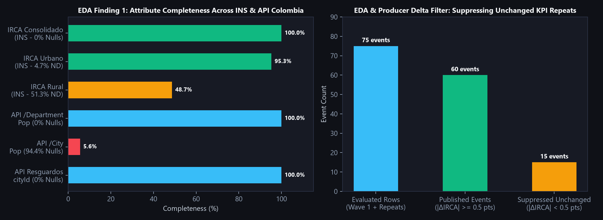
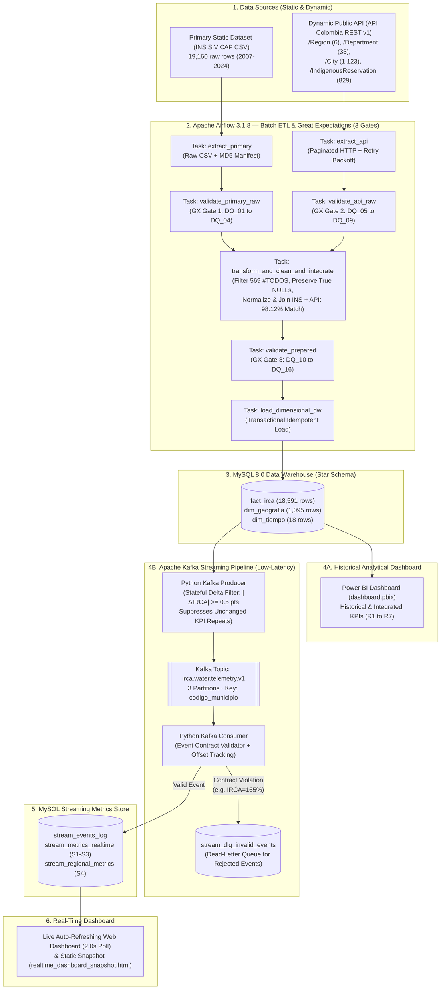
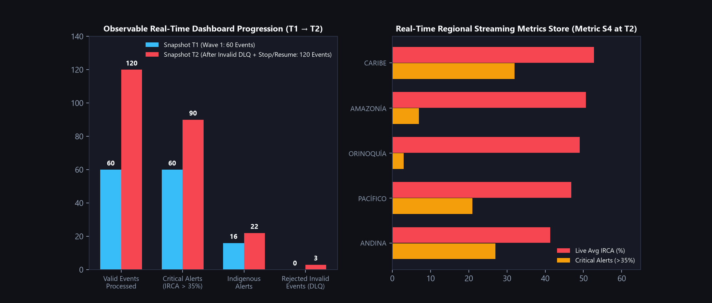

# ETL Project — Final Delivery: Integrated Batch & Real-Time Streaming Data Engineering System (ODS 6 Water Quality in Colombia)

> 🇪🇸 **Versión en Español Disponible:** [README_es.md](README_es.md)
> **Previous Deliveries (Preserved Unchanged):**
> * **Delivery 1 Repository (Baseline):** `https://github.com/Big2Welker/Project1ETLSVG`
> * **Delivery 2 Repository (Batch Automation, API & GX):** `https://github.com/Big2Welker/Project2ETLSVG`

---

## 1. Project Overview and Objectives

* **Project Title:** Integrated Batch and Real-Time Streaming Data Engineering System for Drinking Water Quality Risk (IRCA), Demographic Exposure, and Indigenous Territory Vulnerability in Colombia.
* **Selected SDG:** **SDG 6 – Clean Water and Sanitation** (Target 6.1: Universal and equitable access to safe drinking water; Target 6.b: Participation of local and ethnic communities in water and sanitation management).
* **Problem Statement:** In Colombia, while major urban capitals consistently report safe drinking water (**IRCA $\le 5.0\%$**, *"No Risk"*), hundreds of rural municipalities and indigenous territories consume water classified as *"Medium Risk"* ($14.1\% - 35.0\%$), *"High Risk"* ($35.1\% - 80.0\%$), or *"Sanitarily Inviable"* ($80.1\% - 100.0\%$) under Resolution 2115 of 2007.
* **Refined Final Delivery Objectives:**
  1. Consolidate and automate the **Batch ETL Pipeline** (orchestrated with **Apache Airflow 3.1.8**) that extracts `19,160` historical records from the **National Institute of Health (INS – SIVICAP)** and integrates them with demographic, regional, and **Indigenous Reservation** data extracted programmatically from **API Colombia**, enforcing **16 Data Quality rules across 3 Great Expectations gates** before loading a **MySQL 8.0 Star Schema Data Warehouse** (`18,591` atomic municipal facts).
  2. Extend the architecture with a **Low-Latency Event Streaming Pipeline** powered by **Apache Kafka (`confluent-kafka`)** where a stateful Python Producer publishes meaningful municipal water quality telemetry updates (`|ΔIRCA| >= 0.5` pts or risk-level transitions) into topic `irca.water.telemetry.v1`, and a Python Consumer validates incoming events against a strict **Event Contract**, routes malformed events to a **Dead-Letter Queue (DLQ)**, and continuously updates **4+ real-time streaming metrics** in a **MySQL Streaming Metrics Store** feeding a **Real-Time Dashboard**.

### 1.1 Distinction Between Batch Analytical Requirements (R1–R7) and Low-Latency Streaming Requirements (S1–S4)

| Dimension | Batch Analytical Layer (R1 to R7) | Real-Time / Low-Latency Streaming Layer (S1 to S4) |
| :--- | :--- | :--- |
| **Primary Purpose** | Long-term structural policy analysis, multi-year trend evaluation (2007–2024), departmental budget allocation, and demographic/indigenous gap auditing. | Immediate operational surveillance of incoming municipal water sample alerts, sanitary emergency detection (`IRCA > 80%`), and live regional/indigenous risk monitoring. |
| **Latency & Cadence** | Scheduled `@daily` / periodic batch consolidation via **Apache Airflow 3.1.8**. | Sub-second event ingestion via **Apache Kafka** (`irca.water.telemetry.v1`) and **2.0-second** auto-refresh in the **Real-Time Dashboard**. |
| **Refined Requirements** | **R1:** 18-year national evolution (General, Urban, Rural).<br>**R2 (Corrected):** Unbiased Top 5 critical departments using `irca_general` (eliminating `COALESCE(irca, 0)`).<br>**R3:** Intra-departmental Rural vs. Urban gap.<br>**R4:** `65` chronic high-risk municipalities (5 consecutive years $>35\%$).<br>**R5:** Historical rural risk reduction leaders (2007 vs. 2024).<br>**R6 (API Integrated):** Demographic exposure (`10.12M` estimated exposed inhabitants) & density.<br>**R7 (API Integrated):** Water vulnerability gap across `207` municipalities with `829` Indigenous Reservations. | **S1 (Rolling Window IRCA & Throughput):** Live 50-event rolling average Consolidated & Rural IRCA + cumulative valid vs. contract-rejected event counters.<br>**S2 (Real-Time Sanitary Alert Monitor):** Instant counter and feed of incoming High-Risk ($>35\%$) and Sanitarily Inviable ($>80\%$) municipal spikes.<br>**S3 (Live Indigenous Territory Gap):** Continuously updated IRCA average and alert counter in municipalities with Indigenous Reservations vs. non-indigenous territories.<br>**S4 (Live Regional Risk Aggregation):** Continuously updated risk average, max IRCA, and alert counts across Colombia's 6 Natural Regions. |
| **Why Streaming Adds Value** | Batch processing looks backward at closed annual/periodic snapshots. It cannot alert sanitary authorities immediately when a new laboratory sample in a municipality spikes from Low Risk to Sanitarily Inviable. | Low-latency streaming processes each new sample or significant $\Delta\text{IRCA}$ shift as an independent event, enabling instant sanitary alerts while suppressing redundant unchanged readings. |

---

## 2. Data Sources and Exploratory Data Analysis (EDA)

### 2.1 Data Sources Summary
1. **Primary Static Dataset (INS – SIVICAP CSV):** [data/raw/primary/Calidad_del_Agua_para_Consumo_Humano_en_Colombia_20260905.csv](data/raw/primary/Calidad_del_Agua_para_Consumo_Humano_en_Colombia_20260905.csv) (`19,160` raw rows covering `2007–2024` across `7` columns: `DepartamentoCodigo`, `Departamento`, `MunicipioCodigo`, `Municipio`, `Año`, `IRCA`, `Nivel de riesgo`, `IRCAurbano`, `Nivel de riesgo urbano`, `IRCArural`, `Nivel de riesgo rural`).
2. **Dynamic Public API Source (API Colombia REST v1):** Programmatically extracted via [src/extract_api.py](src/extract_api.py) from `https://api-colombia.com/api/v1`:
   * `GET /api/v1/Region` (`6` natural regions).
   * `GET /api/v1/Department` (`33` departments with `100%` complete `population` and `surface`).
   * `GET /api/v1/City/pagedList` (`1,123` paginated municipalities).
   * `GET /api/v1/IndigenousReservation/pagedList` (`829` paginated indigenous reservations).
3. **Streaming Event Source (DW Replay & Telemetry Simulation):** Generated by [streaming/kafka_producer.py](streaming/kafka_producer.py) by replaying validated municipal records from `fact_irca` joined with `dim_geografia` and `dim_tiempo` (explicitly tagged with `"simulation_mode": "HISTORICAL_REPLAY_SIMULATION"`), applying a stateful delta filter (`|ΔIRCA| >= 0.5` pts or category change) so unchanged KPI values are never repeatedly published.

### 2.2 Key EDA & Data Profiling Findings and Their Engineering Impact
*(Full executable profiling in [notebooks/data_profiling.ipynb](notebooks/data_profiling.ipynb), [notebooks/data_profiling.py](notebooks/data_profiling.py), and [docs/evidence/profiling_summary.json](docs/evidence/profiling_summary.json))*

| Dataset / Attribute | Quantitative EDA Finding | How It Informed Cleaning, Transformation, DQ Rules & Streaming |
| :--- | :--- | :--- |
| **INS CSV: `#TODOS` Aggregate Rows** | Exactly **`569` rows ($2.97\%$)** out of `19,160` contain `#TODOS` (departmental/national summary rows). | Monitored as a Warning in Raw Gate 1 (**DQ_03**), filtered out in transformation rule **T01** (`19,160 - 569 = 18,591`), and strictly prohibited in Prepared Gate 3 (**DQ_15**) and in the Streaming Event Contract. |
| **INS CSV: `'ND'` Markers in `IRCArural` vs. `IRCA`** | Among the `18,591` municipal rows, `IRCArural` has **`9,538` `'ND'` strings ($51.30\%$)** and `8,968` rows ($48.24\%$) have only one zone measured, whereas consolidated `IRCA` has **`0` `'ND'` ($100\%$ complete)**. | Proved why Delivery 1's `COALESCE(irca_rural, 0)` biased R2 by treating missing rural data as `0%` ("No Risk"). Transformation rule **T02** converts `'ND'` to true SQL `NULL` and uses `irca_general` for R2, R6, R7, and Kafka streaming events. |
| **API Colombia: `/City` vs. `/Department` Population** | `/City/pagedList` has **`1,060` nulls ($94.39\%$)** in `population`, whereas `/Department` has **`0` nulls ($100\%$ complete across 33 departments)**. | Flagged via Warning rule **DQ_07** in Raw Gate 2. Discarded municipal API population and designed R6 exposure around departmental population (`poblacion_depto_api`, validated by Critical rule **DQ_06**). |
| **API Colombia: `/IndigenousReservation` Schema Typo** | All `829` reservations have **`0%` nulls in `cityId`**, but the API JSON contains a misspelled key `"deparmentId"` (missing the first `t`). | Validated `cityId` non-nullness via Critical rule **DQ_08** and linked reservations through the normalized municipality bridge (`98.12%` match rate across `fact_irca`). |



---

## 3. System Architecture

*(Also documented in [docs/ETL_Architecture.md](docs/ETL_Architecture.md))*

The diagram below implements **Figure 1 (Integrated Batch and Streaming Architecture)**, connecting our static and API sources through Apache Airflow 3.1.8 and Great Expectations into the MySQL 8.0 Data Warehouse, which feeds both the Historical Power BI Dashboard and the Apache Kafka Streaming Pipeline (`Producer -> Topic -> Consumer -> Streaming Metrics Store -> Real-Time Dashboard`):



---

## 4. Batch ETL Pipeline (Apache Airflow 3.1.8)

Orchestrated in [dags/etl_irca_api_dag.py](dags/etl_irca_api_dag.py) using the Airflow 3.1.8 TaskFlow API (`from airflow.sdk import dag, task`):

1. **Parallel Extraction (`extract_primary` & `extract_api`):**
   * [src/extract_primary.py](src/extract_primary.py) verifies the raw INS CSV without silent modifications and writes an audit manifest with its MD5 checksum.
   * [src/extract_api.py](src/extract_api.py) executes paginated HTTP GET requests (`retries=2`, exponential backoff) against the 4 API Colombia endpoints and persists raw JSON snapshots into `data/raw/api/`.
2. **Independent Raw Validation Gates (`validate_primary_raw` & `validate_api_raw`):**
   * Each branch is validated independently in **Great Expectations** (`retries=0`) before any business transformation occurs.
3. **Transformation, Cleaning & Integration (`transform_and_clean_and_integrate`):**
   * Implemented in [src/transform_integrate.py](src/transform_integrate.py): removes the `569` `#TODOS` summary rows, converts `'ND'` strings to true `NULL`s, computes `brecha_rural_urbana`, normalizes department/municipality names (NFD accent removal + homologation map), and integrates API Colombia attributes (`98.12%` fact match rate).
4. **Prepared Data Validation Gate (`validate_prepared`):**
   * Evaluates the assembled Star Schema tables (`dim_tiempo`, `dim_geografia`, `fact_irca`) before database loading. Any Critical failure raises `RuntimeError` and blocks `load_dimensional_dw` (`upstream_failed`).
5. **Transactional Dimensional Load (`load_dimensional_dw`):**
   * Implemented in [src/load_dw.py](src/load_dw.py): executes an atomic SQL transaction in MySQL 8.0 and verifies pre/post row counts in `etl_batch_audit`.

---

## 5. Data Quality (Great Expectations 1.24.0)

Implemented in [gx/gx_validation.py](gx/gx_validation.py) across **3 explicit validation gates** (`16` traceable rules):

| Rule ID | Gate / Suite | Target Attribute(s) | Expectation & Threshold | Severity | Pipeline Action on Violation |
| :--- | :--- | :--- | :--- | :--- | :--- |
| **DQ_01** | Gate 1 (`primary_raw`) | Primary CSV Table | `ExpectTableRowCountToBeBetween(15000, 25000)` | **Critical** | Stop Primary Branch (`failed`) |
| **DQ_02** | Gate 1 (`primary_raw`) | `MunicipioCodigo`, `Año`, `IRCA` | `ExpectColumnValuesToNotBeNull` ($100\%$) | **Critical** | Stop Primary Branch (`failed`) |
| **DQ_03** | Gate 1 (`primary_raw`) | `MunicipioCodigo` (`#TODOS`) | `ExpectColumnValuesToNotMatchRegex('^#TODOS$')` (`mostly=0.96`) | **Warning** | Log `569` `#TODOS` rows & proceed to filter in T01 |
| **DQ_04** | Gate 1 (`primary_raw`) | `IRCArural` (`'ND'` strings) | `ExpectColumnValuesToNotMatchRegex('^ND$')` (`mostly=0.45`) | **Warning** | Log `9,538` `'ND'` markers & convert to `NULL` in T02 |
| **DQ_05** | Gate 2 (`api_raw`) | API `/Department` JSON | `ExpectTableRowCountToBeBetween(33, 33)` | **Critical** | Stop API Branch (`failed`) |
| **DQ_06** | Gate 2 (`api_raw`) | `population`, `surface` (Dept) | `ExpectColumnValuesToNotBeNull` & `> 0` ($100\%$) | **Critical** | Stop API Branch (`failed`) |
| **DQ_07** | Gate 2 (`api_raw`) | `population` (API `/City`) | `ExpectColumnValuesToNotBeNull` (`mostly=0.05`) | **Warning** | Audit $94.39\%$ null city population; use Dept pop |
| **DQ_08** | Gate 2 (`api_raw`) | `id`, `name`, `cityId` (Resguardos) | `ExpectColumnValuesToNotBeNull` ($100\%$) | **Critical** | Stop API Branch (`failed`) |
| **DQ_09** | Gate 2 (`api_raw`) | `regionId` (API `/Department`) | `ExpectColumnValuesToBeBetween(1, 6)` ($100\%$) | **Critical** | Stop API Branch (`failed`) |
| **DQ_10** | Gate 3 (`prepared_dw`) | `fact_irca.irca_general` | `ExpectColumnValuesToBeBetween(0.0, 100.0)` ($100\%$) | **Critical** | **Block DW Load (`upstream_failed`)** |
| **DQ_11** | Gate 3 (`prepared_dw`) | `irca_urbano`, `irca_rural` | `ExpectColumnValuesToBeBetween(0.0, 100.0)` (ignoring `NULL`) | **Critical** | **Block DW Load (`upstream_failed`)** |
| **DQ_12** | Gate 3 (`prepared_dw`) | `fact_irca.nivel_riesgo_general` | `ExpectColumnValuesToBeInSet` (5 legal categories) | **Critical** | **Block DW Load (`upstream_failed`)** |
| **DQ_13** | Gate 3 (`prepared_dw`) | `(fk_geografia, fk_tiempo)` | `ExpectCompoundColumnsToBeUnique` ($100\%$) | **Critical** | **Block DW Load (`upstream_failed`)** |
| **DQ_14** | Gate 3 (`prepared_dw`) | `dim_geografia.codigo_municipio` | `ExpectColumnValuesToBeUnique` ($100\%$) | **Critical** | **Block DW Load (`upstream_failed`)** |
| **DQ_15** | Gate 3 (`prepared_dw`) | `dim_geografia.poblacion_depto_api` | `ExpectColumnValuesToBeBetween(10000, 15000000)` ($100\%$) | **Critical** | **Block DW Load (`upstream_failed`)** |
| **DQ_16** | Gate 3 (`prepared_dw`) | `dim_tiempo.anio` | `ExpectColumnValuesToBeBetween(2007, 2024)` ($100\%$) | **Critical** | **Block DW Load (`upstream_failed`)** |

---

## 6. Data Warehouse (MySQL 8.0 Star Schema & Streaming Store)

Defined in [sql/create_dw.sql](sql/create_dw.sql) and documented in [docs/Star_Schema.md](docs/Star_Schema.md):

* **Batch Dimensional Tables:**
  * **`dim_tiempo` (`18` rows):** `sk_tiempo` (PK), `anio` (`2007–2024` UNIQUE), `decada`, `es_lustro_reciente`.
  * **`dim_geografia` (`1,095` rows):** `sk_geografia` (PK), `codigo_municipio` (UNIQUE DIVIPOLA business key), `municipio`, `codigo_departamento`, `departamento`, enriched with API Colombia attributes: `region_geografica`, `poblacion_depto_api`, `superficie_depto_km2_api`, `densidad_depto_hab_km2`, `total_resguardos_indigenas`, and `tiene_resguardo_indigena`.
  * **`fact_irca` (`18,591` rows):** Grain = **1 row per municipality $\times$ calendar year** (`PRIMARY KEY (fk_geografia, fk_tiempo)`). Measures: `irca_general` ($100\%$ complete), `irca_urbano` (nullable), `irca_rural` (nullable), `brecha_rural_urbana`, and `nivel_riesgo_general`.
* **Streaming Metrics Store Tables:**
  * **`stream_events_log`:** Idempotent log (`event_id` PK) of all contract-validated Kafka events.
  * **`stream_metrics_realtime`:** Continuously updated snapshot table storing Metrics **S1**, **S2**, and **S3**.
  * **`stream_regional_metrics`:** Continuously updated regional aggregation table (`region_geografica` PK) storing Metric **S4**.
  * **`stream_dlq_invalid_events`:** Dead-Letter Queue storing rejected payloads, violation codes, and Kafka partition/offset metadata.

---

## 7. Batch Analytical Dashboard (Power BI — R1 to R7)

Located at [docs/dashboard/dashboard.pbix](docs/dashboard/dashboard.pbix) (connected directly to MySQL `dw_calidad_agua_colombia`; SQL queries in [sql/analytical_queries.sql](sql/analytical_queries.sql) and exported outputs in [docs/evidence/analytical_results_r1_r7.json](docs/evidence/analytical_results_r1_r7.json)):

* **Page 1 — Historical IRCA Surveillance (R1 to R5):**
  * **R1 (National Trend 2007–2024):** National consolidated IRCA improved from **$28.20\%$ (2007) to $10.72\%$ (2024)**, and Urban IRCA fell from **$27.52\%$ to $8.79\%$**, but Rural IRCA in 2024 remains in **Medium Risk at $22.65\%$** (nearly $3\times$ the urban risk).
  * **R2 (Corrected Departmental Ranking 2024):** Eliminating `COALESCE(..., 0)` reveals the true 2024 Top 5 highest-risk departments: **1. Chocó ($50.83\%$ – High Risk)**, **2. Guainía ($32.80\%$)**, **3. Cesar ($22.09\%$)**, **4. Nariño ($20.31\%$, Rural $37.41\%$)**, and **5. Bolívar ($19.10\%$)**.
  * **R3 (Rural–Urban Gap):** Highest intra-departmental gaps occur in **Caldas ($+56.98\text{ pts}$: $69.22\%$ rural vs. $12.24\%$ urban)**, **Huila ($+52.81\text{ pts}$)**, and **Vaupés ($+47.99\text{ pts}$)**.
  * **R4 (Chronic High-Risk Municipalities):** **`65` municipalities** remained in High Risk or Sanitarily Inviable ($>35\%$) across all 5 years of 2020–2024, led by **Zaragoza ($74.66\%$)**, **Roncesvalles ($72.76\%$)**, **Bosconia ($70.80\%$)**, and **Margarita ($70.68\%$)**.
  * **R5 (Historical Rural Progress 2007 vs. 2024):** Greatest rural risk reductions were achieved by **Guaviare ($-87.10\text{ pts}$)**, **Huila ($-52.33\text{ pts}$)**, **Meta ($-51.74\text{ pts}$)**, and **Magdalena ($-50.60\text{ pts}$)**.
* **Page 2 — API Colombia Value: Demographic Exposure (R6) & Indigenous Territories (R7):**
  * **R6 (Demographic Exposure & Density):** An estimated **`10,127,121` inhabitants** live in jurisdictions with Medium/High water risk ($>14\%$ in 2024), led by **Bolívar (`981,923` exposed)**, **Nariño (`941,305`)**, **Santander (`891,802`)**, and **Córdoba (`759,476`)**.
  * **R7 (Indigenous Reservations Water Gap):** Across the **`207` municipalities with Indigenous Reservations** (`829` reservations from API Colombia), historical Rural IRCA averages **$42.14\%$ (High Risk)** vs. **$37.31\%$** in non-indigenous municipalities (**$+4.83\text{ pts}$ gap**). In 2024, extreme sanitary emergencies occur in **Zaragoza (`4` reservations, $96.50\%$ Inviable)** and **Tadó (`6` reservations, $93.60\%$ Inviable)**.

---

## 8. Streaming Pipeline (Apache Kafka Producer, Event Contract & Consumer)

### 8.1 Event Generation Strategy & Unchanged KPI Suppression ([streaming/kafka_producer.py](streaming/kafka_producer.py))
* **Source & Cadence:** `IRCATelemetryProducer` queries validated municipal measurements from the MySQL Data Warehouse (`fact_irca` joined with `dim_geografia` and `dim_tiempo`) and publishes events to Kafka topic **`irca.water.telemetry.v1`** (`3` partitions).
* **Justification for Avoiding Unchanged KPI Repeats:** Re-publishing identical KPI values wastes broker bandwidth and artificially biases rolling window averages. Our producer maintains an in-memory state dictionary `municipal_state[codigo_municipio]` and **suppresses any record where `|irca_general - prev_irca| < 0.5` and the risk category has not changed** (`suppressed_unchanged_events = 15` verified in Experiment 1).
* **Topic Partition Key:** `codigo_municipio` (DANE DIVIPOLA code), guaranteeing strict chronological ordering of all events belonging to the same municipality within the same Kafka partition.

### 8.2 Formal Event Contract & Validation Rules ([streaming/event_contract.py](streaming/event_contract.py))

| Field | Type | Contract Validation Rule | Role in Contract |
| :--- | :--- | :--- | :--- |
| `event_id` | `str` | Non-empty UUIDv4 (`len >= 8`) | **Unique Event Identifier** (enables idempotency in `stream_events_log`) |
| `event_timestamp` | `str` | Valid ISO-8601 UTC timestamp | **Event Generation Timestamp** |
| `event_key` | `str` | Must equal `codigo_municipio` (not `#TODOS`) | **Selected Kafka Partition Key** |
| `event_type` | `str` | `BASELINE_SAMPLE` \| `DELTA_METRIC_UPDATE` \| `CRITICAL_RISK_SPIKE` | Event classification |
| `simulation_mode` | `str` | `HISTORICAL_REPLAY_SIMULATION` \| `LIVE_TELEMETRY` | Explicit simulation tag |
| `codigo_municipio`, `municipio`, `departamento`, `region_geografica` | `str` | Non-null, non-empty strings | Geographic & API Colombia context |
| `anio_referencia` | `int` | Integer in `[2007, 2030]` | Reference measurement year |
| `irca_general` | `float` | Numeric float strictly in **`[0.0, 100.0]`** | Primary water risk metric |
| `irca_urbano`, `irca_rural` | `float \| None` | Optional float in **`[0.0, 100.0]`** if present | Zonal water risk metrics |
| `delta_irca_prev` | `float` | Numeric float ($\Delta$ vs. previous municipal reading) | Magnitude of risk shift |
| `nivel_riesgo` | `str` | Must be in `{"SIN RIESGO", "RIESGO BAJO", "RIESGO MEDIO", "RIESGO ALTO", "INVIABLE SANITARIAMENTE"}` | Normative Resolution 2115/2007 level |
| `tiene_resguardo_indigena`, `total_resguardos_indigenas`, `poblacion_depto_api` | `int` | `tiene_resguardo` $\in \{0,1\}$, `total_resguardos >= 0`, `poblacion > 0` | API Colombia demographic/indigenous context |

### 8.3 Streaming Metrics Updated by the Consumer ([streaming/kafka_consumer.py](streaming/kafka_consumer.py))
Upon validating each event, `IRCATelemetryConsumer` idempotently logs the event (`INSERT IGNORE INTO stream_events_log`), commits the Kafka offset, and updates **4 streaming metrics** in MySQL:
1. **Metric S1 (Rolling Window IRCA & Throughput):** Rolling 50-event average `rolling_avg_irca_general` and `rolling_avg_irca_rural`, plus `total_valid_events` and `total_rejected_events`.
2. **Metric S2 (Real-Time Critical & Sanitary Inviable Alert Counter):** Cumulative count of High-Risk events (`critical_alerts_count`, `IRCA > 35%`) and extreme Sanitarily Inviable emergencies (`inviable_sanitaria_count`, `IRCA > 80%`).
3. **Metric S3 (Indigenous Territory Real-Time Vulnerability Monitor):** Live average IRCA in municipalities with Indigenous Reservations (`indigenous_rolling_avg_irca`), active indigenous alerts (`indigenous_municipalities_alert_count`), and live gap (`indigenous_gap_pts`) vs. non-indigenous municipalities.
4. **Metric S4 (Regional Real-Time Aggregation):** Continuously updated `stream_regional_metrics` table tracking `events_processed`, `avg_irca_general`, `max_irca_recorded`, and `critical_alerts_count` across all 6 Natural Regions.

---

## 9. Real-Time Dashboard ([streaming/realtime_dashboard.py](streaming/realtime_dashboard.py))

* **Consumer-to-Dashboard Integration & Update Frequency:**
  * The Kafka Consumer writes validated events and updated KPI snapshots directly into the MySQL **Streaming Metrics Store** (`stream_metrics_realtime`, `stream_regional_metrics`, `stream_events_log`, `stream_dlq_invalid_events`).
  * The Real-Time Dashboard server (`http://localhost:8050`, also exported as a self-contained snapshot at [docs/dashboard/realtime_dashboard_snapshot.html](docs/dashboard/realtime_dashboard_snapshot.html)) polls `/api/live-state` every **2.0 seconds** and renders 6 live KPI cards, 3 real-time charts (Rolling IRCA trajectory, Regional Live Risk, Indigenous vs. Non-Indigenous Live Bar), the live feed of recent Kafka events, and the Dead-Letter Queue (DLQ) audit table.
* **Observable Dashboard Changes Across Streaming Waves ([docs/evidence/streaming_experiments_evidence.json](docs/evidence/streaming_experiments_evidence.json)):**

| Streaming Metric / Indicator | Snapshot $T_1$ (After Wave 1: 60 Events) | Snapshot After Invalid Injection (+3 Bad, +5 Valid) | Snapshot $T_2$ (After Wave 2 Recovery: 120 Events) |
| :--- | :---: | :---: | :---: |
| **`total_valid_events` (S1A)** | `60` | `65` | **`120`** |
| **`total_rejected_events` in DLQ (S1B)** | `0` | **`3`** (`IRCA=165%`, `null code`, `corrupt JSON`) | **`3`** |
| **`rolling_avg_irca_general` (S1 - 50 ev)** | `55.43%` | `52.64%` | **`34.62%`** |
| **`rolling_avg_irca_rural` (S1C - 50 ev)** | `70.16%` | `67.80%` | **`59.79%`** |
| **`critical_alerts_count` (`>35%`, S2)** | `60` | `65` | **`90`** |
| **`indigenous_municipalities_alert_count` (S3A)** | `16` | `17` | **`22`** |
| **`indigenous_gap_pts` (S3 Live Gap)** | `-1.31 pts` | `-0.75 pts` | **`+3.60 pts` (`50.58%` vs `46.98%`)** |
| **Last Processed Municipality** | `CÓRDOBA (BOLÍVAR - 45.6%)` | `EL PLAYÓN (SANTANDER - 42.8%)` | **`CALIMA (VALLE DEL CAUCA - 29.9%)`** |



---

## 10. Execution and Reproducibility

### 10.1 Environment Configuration (`.env.example` $\rightarrow$ `.env`)
Copy [.env.example](.env.example) to `.env`. **API Colombia** (`https://api-colombia.com/api/v1`) is an open public REST API requiring **no private API key**:
```bash
cp .env.example .env
```

### 10.2 Option 1: Full Docker Compose Deployment (Airflow 3.1.8 + Kafka 4.4 + MySQL 8.0 + Real-Time Dashboard)
```bash
docker compose up -d
```
* **Apache Airflow 3.1.8 Web UI:** `http://localhost:8080` (DAG: `etl_ods6_irca_colombia_delivery2`)
* **Real-Time Streaming Dashboard UI:** `http://localhost:8050`
* **Apache Kafka Broker (KRaft):** `localhost:29092`
* **MySQL 8.0 Data Warehouse & Streaming Store:** `localhost:3307` (or local `3306`)

### 10.3 Option 2: Local CLI Execution & Verification
```bash
# 1. Install Python dependencies
pip install -r requirements.txt

# 2. Run EDA & Data Profiling
python notebooks/data_profiling.py

# 3. Run End-to-End Batch ETL (Tests A, B, C) + Kafka Streaming Experiments
python src/main.py

# 4. Run Standalone Kafka Streaming Resilience Experiments (Wave 1, Invalid DLQ, Stop/Resume)
python streaming/run_streaming_experiments.py

# 5. Launch Interactive Real-Time Streaming Dashboard Server
python streaming/realtime_dashboard.py --port 8050
```

---

## 11. Functional Evidence Index

All functional execution evidence is stored in `docs/evidence/` and `docs/dashboard/`:

1. **Exploratory Data Analysis & Profiling:**
   * [notebooks/data_profiling.ipynb](notebooks/data_profiling.ipynb), [notebooks/data_profiling.py](notebooks/data_profiling.py), and [docs/evidence/profiling_summary.json](docs/evidence/profiling_summary.json).
2. **Batch ETL, Great Expectations (3 Gates) & DW Reconciliation (Tests A, B, and C):**
   * Gate 1 Primary Raw Success: [docs/evidence/gx_gate1_primary_raw_test_A_success.json](docs/evidence/gx_gate1_primary_raw_test_A_success.json)
   * Gate 2 API Raw Success: [docs/evidence/gx_gate2_api_raw_test_A_success.json](docs/evidence/gx_gate2_api_raw_test_A_success.json)
   * Gate 3 Prepared Success: [docs/evidence/gx_gate3_prepared_test_A_success.json](docs/evidence/gx_gate3_prepared_test_A_success.json)
   * Controlled Critical Failure (Test B – Blocked Load): [docs/evidence/gx_gate3_prepared_test_B_critical_failure.json](docs/evidence/gx_gate3_prepared_test_B_critical_failure.json) and [docs/evidence/gx_gate1_primary_raw_airflow_fail_gate1_primary_null_20261021_155758.json](docs/evidence/gx_gate1_primary_raw_airflow_fail_gate1_primary_null_20261021_155758.json)
   * Safe Rerun Reconciliation (Test C – Zero Duplicates): [docs/evidence/dw_load_reconciliation_test_C_safe_rerun.json](docs/evidence/dw_load_reconciliation_test_C_safe_rerun.json) and [docs/evidence/reliability_tests_summary.json](docs/evidence/reliability_tests_summary.json)
3. **Kafka Streaming Pipeline, Invalid-Event DLQ Experiment & Consumer-Interruption Experiment:**
   * Complete Streaming Evidence JSON: [docs/evidence/streaming_experiments_evidence.json](docs/evidence/streaming_experiments_evidence.json)
   * **Invalid-Event Experiment Result:** 3 invalid payloads (`irca_general = 165.0`, `codigo_municipio = null`, and corrupt JSON bytes) were intercepted by `validate_streaming_event()`, logged in `stream_dlq_invalid_events` (`dlq_id = 1, 2, 3`), and excluded from KPI calculations without halting the consumer.
   * **Consumer-Interruption Experiment Result:** Consumer was stopped after `65` valid events; `55` new municipal events were published to Kafka while offline; upon restart, the consumer resumed from the committed offset and recovered all `55` events (`zero_data_loss_verified = true`, reaching `120` valid events).
4. **Dashboards (Historical Batch & Real-Time Streaming):**
   * Historical Batch Power BI Dashboard: [docs/dashboard/dashboard.pbix](docs/dashboard/dashboard.pbix) and [docs/evidence/analytical_results_r1_r7.json](docs/evidence/analytical_results_r1_r7.json)
   * Real-Time Streaming Dashboard Snapshot & Server: [docs/dashboard/realtime_dashboard_snapshot.html](docs/dashboard/realtime_dashboard_snapshot.html) and [streaming/realtime_dashboard.py](streaming/realtime_dashboard.py)

---

## 12. Engineering Decisions and Limitations

1. **Why Enrich `dim_geografia` Instead of Altering the Fact Table Grain:** API Colombia provides static structural territorial attributes (departmental population, area, natural region, and indigenous reservation counts). Storing them in `dim_geografia` preserves the strict municipal-annual grain of `fact_irca` while enabling both batch (R6–R7) and streaming (S3–S4) segmentation.
2. **Why Stateful Delta Filtering Is Used in the Kafka Producer:** Publishing unchanged historical rows repeatedly creates artificial autocorrelation in streaming windows. Filtering by `|ΔIRCA| >= 0.5` pts or risk-category transitions ensures every Kafka message represents an actionable sanitary state change.
3. **Known Limitations:**
   * **Departmental vs. Municipal Population Granularity:** Because API Colombia's `/City` endpoint has $94.39\%$ null values in `population`, demographic exposure (R6) is estimated by weighting the $100\%$ complete departmental population (`/Department`) by the proportion of affected municipalities in each department.
   * **Streaming Replay Simulation:** Since SIVICAP does not expose a public live websocket of laboratory equipment, streaming events are generated by replaying validated Data Warehouse records in chronological waves (`simulation_mode = HISTORICAL_REPLAY_SIMULATION`).
   * **Single-Broker Kafka Topology:** The Docker Compose stack uses a single-node Apache Kafka 4.4 KRaft broker (`replication_factor = 1`) for local reproducibility; production deployments should use $\ge 3$ brokers with `min.insync.replicas = 2`.
