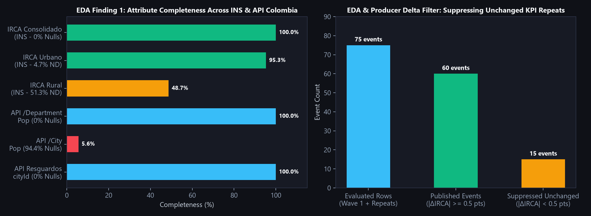
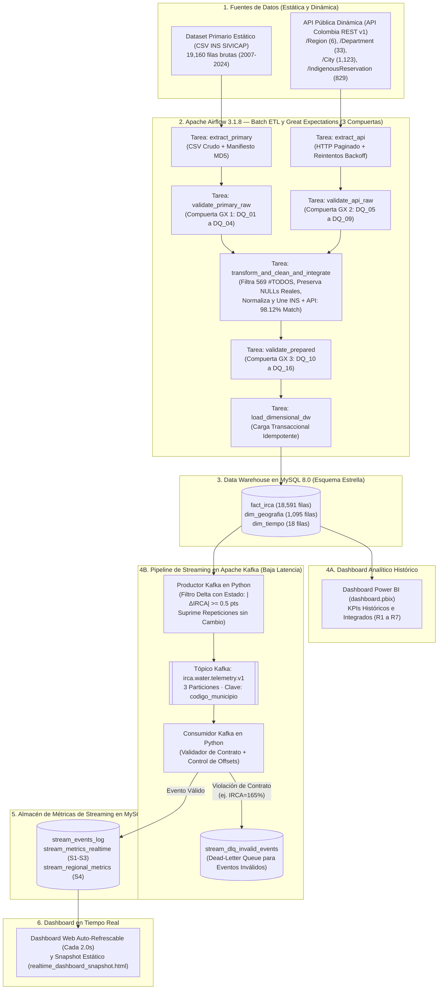
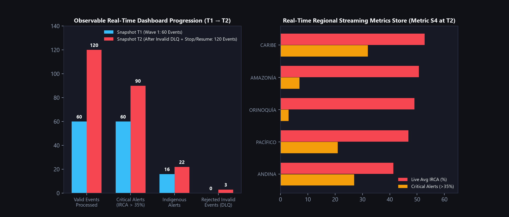

# Proyecto ETL — Entrega Final: Sistema Integrado de Ingeniería de Datos en Batch y Streaming en Tiempo Real (ODS 6 Calidad del Agua en Colombia)

> 🇺🇸 **English Version Available:** [README.md](README.md)
> **Entregas Anteriores (Conservadas Intactas):**
> * **Repositorio Entrega 1 (Línea Base):** `https://github.com/Big2Welker/Project1ETLSVG`
> * **Repositorio Entrega 2 (Automatización Batch, API y GX):** `https://github.com/Big2Welker/Project2ETLSVG`

---

## 1. Descripción General del Proyecto y Objetivos (Project Overview and Objectives)

* **Título del Proyecto:** Sistema Integrado de Ingeniería de Datos en Batch y Streaming en Tiempo Real para el Análisis del Riesgo de la Calidad del Agua (IRCA), Exposición Demográfica y Vulnerabilidad en Territorios Indígenas en Colombia.
* **ODS Seleccionado:** **ODS 6 – Agua Limpia y Saneamiento** (Meta 6.1: Acceso universal y equitativo al agua potable; Meta 6.b: Participación de las comunidades locales e indígenas en la gestión del agua y el saneamiento).
* **Problema en Colombia:** Mientras las principales capitales del país registran niveles de **IRCA $\le 5.0\%$** (*"Sin Riesgo"*), cientos de municipios periféricos, zonas rurales y territorios con presencia de resguardos indígenas consumen agua clasificada en *"Riesgo Medio"* ($14.1\% - 35.0\%$), *"Riesgo Alto"* ($35.1\% - 80.0\%$) o *"Inviable Sanitariamente"* ($80.1\% - 100.0\%$) según la Resolución 2115 de 2007.
* **Objetivos Refinados de la Entrega Final:**
  1. Consolidar y automatizar el **Pipeline ETL por Lotes (Batch)** orquestado en **Apache Airflow 3.1.8**, extrayendo `19,160` registros históricos del **Instituto Nacional de Salud (INS – SIVICAP)** e integrándolos con información demográfica, regional y de **Resguardos Indígenas** extraída programáticamente desde **API Colombia**, aplicando **16 reglas de calidad de datos en 3 compuertas con Great Expectations** antes de cargar el **Data Warehouse en Esquema Estrella en MySQL 8.0** (`18,591` hechos municipales atómicos).
  2. Extender la solución con un **Componente de Streaming de Baja Latencia en Apache Kafka (`confluent-kafka`)**, donde un Productor en Python con filtro de estado publica actualizaciones significativas de telemetría hídrica (`|ΔIRCA| >= 0.5` pts o cambios en el nivel de riesgo) hacia el tópico `irca.water.telemetry.v1`, y un Consumidor en Python valida cada evento contra un **Contrato de Eventos (Event Contract)** explícito, desvía los eventos inválidos hacia una **Cola de Mensajes Fallidos (Dead-Letter Queue - DLQ)** y actualiza continuamente **4+ métricas en tiempo real** en el **Almacén de Métricas de Streaming en MySQL** que alimenta al **Dashboard en Tiempo Real**.

### 1.1 Distinción entre Requisitos Analíticos Batch (R1–R7) y Requisitos de Streaming de Baja Latencia (S1–S4)

| Dimensión | Capa Analítica Batch (R1 a R7) | Capa Operativa de Streaming en Tiempo Real (S1 a S4) |
| :--- | :--- | :--- |
| **Propósito Principal** | Evaluación estructural de políticas públicas a largo plazo, análisis de series históricas (2007–2024), priorización presupuestal departamental y auditoría de brechas demográficas e indígenas. | Vigilancia sanitaria operativa inmediata ante la llegada de nuevas muestras municipales de agua, detección de picos de emergencia sanitaria (`IRCA > 80%`) y monitoreo regional/indígena en vivo. |
| **Latencia y Frecuencia** | Ejecución periódica programada (`@daily`) mediante **Apache Airflow 3.1.8**. | Ingesta de eventos en milisegundos vía **Apache Kafka** (`irca.water.telemetry.v1`) y actualización automática cada **2.0 segundos** en el **Dashboard en Tiempo Real**. |
| **Requisitos Refinados** | **R1:** Evolución histórica nacional de 18 años (Consolidado, Urbano, Rural).<br>**R2 (Corregido):** Top 5 departamentos críticos usando `irca_general` (eliminando el sesgo de `COALESCE(irca, 0)`).<br>**R3:** Brecha intradepartamental Rural vs. Urbana.<br>**R4:** `65` municipios crónicos en alto riesgo (5 años seguidos $>35\%$).<br>**R5:** Líderes en reducción histórica del riesgo rural (2007 vs. 2024).<br>**R6 (Integrado con API):** Exposición demográfica (`10.12M` hab. estimados expuestos) y densidad.<br>**R7 (Integrado con API):** Brecha hídrica en `207` municipios con `829` Resguardos Indígenas. | **S1 (Rolling Window IRCA y Rendimiento):** Promedio móvil en ventana deslizante de los últimos 50 eventos (General y Rural) + conteo acumulado de eventos válidos vs. rechazados por contrato.<br>**S2 (Monitor de Alertas Sanitarias en Vivo):** Conteo instantáneo y tabla en vivo de muestras que entran en Riesgo Alto ($>35\%$) o Inviable Sanitariamente ($>80\%$).<br>**S3 (Brecha Indígena en Tiempo Real):** Promedio en vivo de IRCA y contador de alertas en municipios con Resguardos Indígenas frente a municipios sin resguardos.<br>**S4 (Agregación Regional en Vivo):** Promedio de riesgo, máximo IRCA registrado y alertas críticas actualizadas continuamente en las 6 Regiones Naturales. |
| **Valor Añadido del Streaming** | El procesamiento Batch analiza cortes anuales cerrados; no puede alertar al instante cuando una nueva muestra de laboratorio en un municipio salta a nivel Inviable Sanitariamente. | El streaming procesa cada nueva muestra o cambio significativo ($\Delta\text{IRCA}$) como un evento individual de baja latencia, activando alertas inmediatas y suprimiendo lecturas repetidas sin cambio. |

---

## 2. Fuentes de Datos y Análisis Exploratorio de Datos (Data Sources and EDA)

### 2.1 Resumen de Fuentes de Datos
1. **Conjunto de Datos Estático Primario (CSV INS – SIVICAP):** [data/raw/primary/Calidad_del_Agua_para_Consumo_Humano_en_Colombia_20260905.csv](data/raw/primary/Calidad_del_Agua_para_Consumo_Humano_en_Colombia_20260905.csv) (`19,160` filas brutas entre `2007–2024`).
2. **Fuente Dinámica API Pública (API Colombia REST v1):** Extraída programáticamente mediante [src/extract_api.py](src/extract_api.py) desde `https://api-colombia.com/api/v1`:
   * `GET /api/v1/Region` (`6` regiones naturales).
   * `GET /api/v1/Department` (`33` departamentos con `100%` de completitud en `population` y `surface`).
   * `GET /api/v1/City/pagedList` (`1,123` municipios paginados).
   * `GET /api/v1/IndigenousReservation/pagedList` (`829` resguardos indígenas paginados).
3. **Fuente de Eventos de Streaming (Simulación de Telemetría desde el DW):** Generada por [streaming/kafka_producer.py](streaming/kafka_producer.py) reproduciendo registros municipales validados del Data Warehouse (`fact_irca` unido con `dim_geografia` y `dim_tiempo`), identificados explícitamente con `"simulation_mode": "HISTORICAL_REPLAY_SIMULATION"` y filtrados mediante control de estado (`|ΔIRCA| >= 0.5` pts o cambio de categoría) para evitar publicar repetidamente valores de KPI sin cambio.

### 2.2 Hallazgos Clave del EDA / Perfilado y su Impacto en Limpieza, Transformación, Reglas DQ y Streaming
*(Perfilado ejecutable completo en [notebooks/data_profiling.ipynb](notebooks/data_profiling.ipynb), [notebooks/data_profiling.py](notebooks/data_profiling.py) y [docs/evidence/profiling_summary.json](docs/evidence/profiling_summary.json))*

| Dataset / Atributo | Hallazgo Cuantitativo del EDA | Cómo Guió la Limpieza, Transformación, Reglas DQ y Streaming |
| :--- | :--- | :--- |
| **INS CSV: Filas agregadas `#TODOS`** | Exactamente **`569` filas ($2.97\%$)** de las `19,160` contienen `#TODOS` (totales departamentales o nacionales). | Se auditan como Advertencia en la Compuerta 1 (**DQ_03**), se eliminan en la transformación **T01** (`19,160 - 569 = 18,591`), y se prohíben tanto en la Compuerta 3 (**DQ_15**) como en el Contrato de Eventos de Kafka. |
| **INS CSV: Textos `'ND'` en `IRCArural` vs. `IRCA`** | De las `18,591` filas municipales, `IRCArural` tiene **`9,538` valores `'ND'` ($51.30\%$)**, mientras que el `IRCA` consolidado tiene **`0` `'ND'` ($100\%$ completo)**. | Demostró por qué el `COALESCE(irca_rural, 0)` de la Entrega 1 sesgaba R2 al asumir agua perfecta (`0%`) donde no hubo muestra. La regla **T02** convierte `'ND'` a `NULL` real y utiliza `irca_general` para R2, R6, R7 y los eventos de Kafka. |
| **API Colombia: Población en `/City` vs. `/Department`** | `/City/pagedList` presenta **`1,060` nulos ($94.39\%$)** en `population`, mientras `/Department` tiene **`0` nulos ($100\%$ completo en los 33 departamentos)**. | Se documenta mediante la Advertencia **DQ_07** en la Compuerta 2, descartando la población municipal de la API y diseñando R6 sobre la población departamental (`poblacion_depto_api`, validada por la regla Crítica **DQ_06**). |
| **API Colombia: Error tipográfico en `/IndigenousReservation`** | Los `829` resguardos tienen **`0%` nulos en `cityId`**, pero el JSON de la API trae mal escrita la propiedad `"deparmentId"`. | Se valida `cityId` no nulo con la regla Crítica **DQ_08** y se cruzan los resguardos a través del catálogo normalizado de municipios (`98.12%` de coincidencia en `fact_irca`). |



---

## 3. Arquitectura del Sistema (System Architecture)

*(También disponible en [docs/ETL_Architecture.md](docs/ETL_Architecture.md))*

El siguiente diagrama implementa la **Figura 1 (Arquitectura Integrada Batch y Streaming)** de la guía final, conectando las fuentes estáticas y la API a través de Apache Airflow 3.1.8 y Great Expectations hacia el Data Warehouse en MySQL 8.0, el cual alimenta tanto al Dashboard Histórico en Power BI como al Pipeline de Streaming en Apache Kafka (`Productor -> Tópico -> Consumidor -> Almacén de Métricas de Streaming -> Dashboard en Tiempo Real`):



---

## 4. Pipeline ETL por Lotes (Batch ETL Pipeline — Apache Airflow 3.1.8)

Orquestado en [dags/etl_irca_api_dag.py](dags/etl_irca_api_dag.py) utilizando la API TaskFlow de Airflow 3.1.8 (`from airflow.sdk import dag, task`):

1. **Extracción en Paralelo (`extract_primary` y `extract_api`):**
   * [src/extract_primary.py](src/extract_primary.py) verifica el CSV crudo del INS sin modificarlo silenciosamente y genera un manifiesto JSON con su hash MD5.
   * [src/extract_api.py](src/extract_api.py) consume de forma paginada los 4 endpoints de API Colombia (`retries=2`, backoff exponencial) y guarda los lotes JSON crudos en `data/raw/api/`.
2. **Compuertas Independientes de Validación Cruda (`validate_primary_raw` y `validate_api_raw`):**
   * Cada rama se audita por separado en **Great Expectations** (`retries=0`) antes de aplicar transformaciones de negocio.
3. **Transformación, Limpieza e Integración (`transform_and_clean_and_integrate`):**
   * Implementada en [src/transform_integrate.py](src/transform_integrate.py): filtra las `569` filas `#TODOS`, convierte `'ND'` en `NULL` real, calcula `brecha_rural_urbana`, normaliza nombres sin tildes y une ambas fuentes logrando un **`98.12%` de coincidencia** en `fact_irca`.
4. **Compuerta de Validación de Datos Preparados (`validate_prepared`):**
   * Evalúa las tablas del Esquema Estrella antes de tocar la base de datos. Cualquier fallo Crítico detiene inmediatamente el flujo y deja `load_dimensional_dw` en estado `upstream_failed`.
5. **Carga Dimensional Transaccional (`load_dimensional_dw`):**
   * Implementada en [src/load_dw.py](src/load_dw.py): ejecuta una transacción atómica e idempotente en MySQL 8.0 y registra la conciliación en `etl_batch_audit`.

---

## 5. Calidad de Datos (Data Quality — Great Expectations 1.24.0)

Implementada en [gx/gx_validation.py](gx/gx_validation.py) a través de **3 compuertas explícitas** (`16` reglas trazables):

| ID Regla | Compuerta / Suite | Atributo(s) | Expectation y Umbral | Severidad | Respuesta del Pipeline ante Fallo |
| :--- | :--- | :--- | :--- | :--- | :--- |
| **DQ_01** | Compuerta 1 (`primary_raw`) | Tabla CSV Primaria | `ExpectTableRowCountToBeBetween(15000, 25000)` | **Crítica** | Detiene Rama Primaria (`failed`) |
| **DQ_02** | Compuerta 1 (`primary_raw`) | `MunicipioCodigo`, `Año`, `IRCA` | `ExpectColumnValuesToNotBeNull` ($100\%$) | **Crítica** | Detiene Rama Primaria (`failed`) |
| **DQ_03** | Compuerta 1 (`primary_raw`) | `MunicipioCodigo` (`#TODOS`) | `ExpectColumnValuesToNotMatchRegex('^#TODOS$')` (`mostly=0.96`) | **Advertencia** | Registra `569` filas `#TODOS` y continúa para filtrar en T01 |
| **DQ_04** | Compuerta 1 (`primary_raw`) | `IRCArural` (textos `'ND'`) | `ExpectColumnValuesToNotMatchRegex('^ND$')` (`mostly=0.45`) | **Advertencia** | Registra `9,538` `'ND'` y los convierte a `NULL` en T02 |
| **DQ_05** | Compuerta 2 (`api_raw`) | JSON `/Department` API | `ExpectTableRowCountToBeBetween(33, 33)` | **Crítica** | Detiene Rama API (`failed`) |
| **DQ_06** | Compuerta 2 (`api_raw`) | `population`, `surface` (Depto) | `ExpectColumnValuesToNotBeNull` y `> 0` ($100\%$) | **Crítica** | Detiene Rama API (`failed`) |
| **DQ_07** | Compuerta 2 (`api_raw`) | `population` (API `/City`) | `ExpectColumnValuesToNotBeNull` (`mostly=0.05`) | **Advertencia** | Audita $94.39\%$ nulos municipales; usa población departamental |
| **DQ_08** | Compuerta 2 (`api_raw`) | `id`, `name`, `cityId` (Resguardos) | `ExpectColumnValuesToNotBeNull` ($100\%$) | **Crítica** | Detiene Rama API (`failed`) |
| **DQ_09** | Compuerta 2 (`api_raw`) | `regionId` (API `/Department`) | `ExpectColumnValuesToBeBetween(1, 6)` ($100\%$) | **Crítica** | Detiene Rama API (`failed`) |
| **DQ_10** | Compuerta 3 (`prepared_dw`) | `fact_irca.irca_general` | `ExpectColumnValuesToBeBetween(0.0, 100.0)` ($100\%$) | **Crítica** | **Bloquea Carga al DW (`upstream_failed`)** |
| **DQ_11** | Compuerta 3 (`prepared_dw`) | `irca_urbano`, `irca_rural` | `ExpectColumnValuesToBeBetween(0.0, 100.0)` (ignorando `NULL`) | **Crítica** | **Bloquea Carga al DW (`upstream_failed`)** |
| **DQ_12** | Compuerta 3 (`prepared_dw`) | `fact_irca.nivel_riesgo_general` | `ExpectColumnValuesToBeInSet` (5 categorías oficiales) | **Crítica** | **Bloquea Carga al DW (`upstream_failed`)** |
| **DQ_13** | Compuerta 3 (`prepared_dw`) | `(fk_geografia, fk_tiempo)` | `ExpectCompoundColumnsToBeUnique` ($100\%$) | **Crítica** | **Bloquea Carga al DW (`upstream_failed`)** |
| **DQ_14** | Compuerta 3 (`prepared_dw`) | `dim_geografia.codigo_municipio` | `ExpectColumnValuesToBeUnique` ($100\%$) | **Crítica** | **Bloquea Carga al DW (`upstream_failed`)** |
| **DQ_15** | Compuerta 3 (`prepared_dw`) | `dim_geografia.poblacion_depto_api` | `ExpectColumnValuesToBeBetween(10000, 15000000)` ($100\%$) | **Crítica** | **Bloquea Carga al DW (`upstream_failed`)** |
| **DQ_16** | Compuerta 3 (`prepared_dw`) | `dim_tiempo.anio` | `ExpectColumnValuesToBeBetween(2007, 2024)` ($100\%$) | **Crítica** | **Bloquea Carga al DW (`upstream_failed`)** |

---

## 6. Data Warehouse (Esquema Estrella en MySQL 8.0 y Almacén de Streaming)

Definido en [sql/create_dw.sql](sql/create_dw.sql) y documentado en [docs/Star_Schema.md](docs/Star_Schema.md):

* **Tablas Dimensionales Batch:**
  * **`dim_tiempo` (`18` filas):** `sk_tiempo` (PK), `anio` (`2007–2024` UNIQUE), `decada`, `es_lustro_reciente`.
  * **`dim_geografia` (`1,095` filas):** `sk_geografia` (PK), `codigo_municipio` (UNIQUE DIVIPOLA), `municipio`, `codigo_departamento`, `departamento`, enriquecida con API Colombia: `region_geografica`, `poblacion_depto_api`, `superficie_depto_km2_api`, `densidad_depto_hab_km2`, `total_resguardos_indigenas` y `tiene_resguardo_indigena`.
  * **`fact_irca` (`18,591` filas):** Grano = **1 fila por municipio $\times$ año calendario** (`PRIMARY KEY (fk_geografia, fk_tiempo)`). Medidas: `irca_general` ($100\%$ completa), `irca_urbano` (nullable), `irca_rural` (nullable), `brecha_rural_urbana` y `nivel_riesgo_general`.
* **Tablas del Almacén de Métricas de Streaming:**
  * **`stream_events_log`:** Registro idempotente (`event_id` PK) de todos los eventos de Kafka validados por contrato.
  * **`stream_metrics_realtime`:** Tabla de instantáneas actualizada continuamente con las Métricas **S1**, **S2** y **S3**.
  * **`stream_regional_metrics`:** Tabla de agregación regional en vivo (`region_geografica` PK) para la Métrica **S4**.
  * **`stream_dlq_invalid_events`:** Dead-Letter Queue que almacena los eventos rechazados, el código de violación y su partición/offset en Kafka.

---

## 7. Dashboard Analítico Batch (Power BI — Requisitos R1 a R7)

Ubicado en [docs/dashboard/dashboard.pbix](docs/dashboard/dashboard.pbix) (conectado a MySQL `dw_calidad_agua_colombia`; consultas SQL en [sql/analytical_queries.sql](sql/analytical_queries.sql) y resultados exportados en [docs/evidence/analytical_results_r1_r7.json](docs/evidence/analytical_results_r1_r7.json)):

* **Página 1 — Vigilancia Histórica IRCA (R1 a R5):**
  * **R1 (Evolución Nacional 2007–2024):** El IRCA Consolidado nacional bajó de **$28.20\%$ (2007) a $10.72\%$ (2024)** y el Urbano de **$27.52\%$ a $8.79\%$**, pero el IRCA Rural en 2024 sigue en **Riesgo Medio con $22.65\%$** (casi el triple del riesgo urbano).
  * **R2 (Ranking Departamental Corregido 2024):** Al eliminar `COALESCE(..., 0)`, el Top 5 real de mayor riesgo en 2024 es: **1. Chocó ($50.83\%$ – Riesgo Alto)**, **2. Guainía ($32.80\%$)**, **3. Cesar ($22.09\%$)**, **4. Nariño ($20.31\%$, Rural $37.41\%$)** y **5. Bolívar ($19.10\%$)**.
  * **R3 (Brecha Rural–Urbana):** Las mayores brechas internas ocurren en **Caldas ($+56.98\text{ pts}$: $69.22\%$ rural vs. $12.24\%$ urbano)**, **Huila ($+52.81\text{ pts}$)** y **Vaupés ($+47.99\text{ pts}$)**.
  * **R4 (Municipios Crónicos en Alto Riesgo):** **`65` municipios** permanecieron en Riesgo Alto o Inviable ($>35\%$) durante los 5 años seguidos entre 2020 y 2024, liderados por **Zaragoza ($74.66\%$)**, **Roncesvalles ($72.76\%$)**, **Bosconia ($70.80\%$)** y **Margarita ($70.68\%$)**.
  * **R5 (Progreso Histórico Rural 2007 vs. 2024):** Las mayores reducciones de riesgo rural las lograron **Guaviare ($-87.10\text{ pts}$)**, **Huila ($-52.33\text{ pts}$)**, **Meta ($-51.74\text{ pts}$)** y **Magdalena ($-50.60\text{ pts}$)**.
* **Página 2 — Valor de API Colombia: Exposición Demográfica (R6) y Resguardos Indígenas (R7):**
  * **R6 (Exposición Demográfica y Densidad):** Se estiman **`10,127,121` habitantes** expuestos en jurisdicciones con riesgo medio/alto ($>14\%$ en 2024), encabezados por **Bolívar (`981,923` hab.)**, **Nariño (`941,305`)**, **Santander (`891,802`)** y **Córdoba (`759,476`)**.
  * **R7 (Brecha en Municipios con Resguardos Indígenas):** En los **`207` municipios con Resguardos Indígenas** (`829` resguardos de API Colombia), el IRCA Rural histórico promedia **$42.14\%$ (Riesgo Alto)** frente a **$37.31\%$** en municipios sin resguardos (**$+4.83\text{ pts}$ de brecha**), con emergencias sanitarias extremas en 2024 en **Zaragoza (`4` resguardos, $96.50\%$ Inviable)** y **Tadó (`6` resguardos, $93.60\%$ Inviable)**.

---

## 8. Pipeline de Streaming (Productor Kafka, Contrato de Eventos y Consumidor)

### 8.1 Estrategia de Generación de Eventos y Supresión de KPIs sin Cambio ([streaming/kafka_producer.py](streaming/kafka_producer.py))
* **Fuente y Frecuencia:** `IRCATelemetryProducer` consulta las mediciones municipales validadas del Data Warehouse en MySQL (`fact_irca` unido con `dim_geografia` y `dim_tiempo`) y publica eventos en el tópico de Kafka **`irca.water.telemetry.v1`** (`3` particiones).
* **Justificación para Evitar Repetir KPIs sin Cambio:** Publicar repetidamente el mismo valor de KPI sin cambio contamina las ventanas deslizantes en tiempo real. Nuestro productor mantiene un diccionario de estado en memoria `municipal_state[codigo_municipio]` y **suprime cualquier registro donde `|irca_general - prev_irca| < 0.5` y la categoría de riesgo no haya cambiado** (`suppressed_unchanged_events = 15` comprobado en el Experimento 1).
* **Clave de Partición Seleccionada (`event_key`):** `codigo_municipio` (código DANE DIVIPOLA), garantizando que todos los eventos de un mismo municipio lleguen en orden cronológico estricto a la misma partición de Kafka.

### 8.2 Contrato Formal de Eventos y Reglas de Validación ([streaming/event_contract.py](streaming/event_contract.py))

| Campo | Tipo | Regla de Validación del Contrato | Rol en el Contrato |
| :--- | :--- | :--- | :--- |
| `event_id` | `str` | UUIDv4 no vacío (`len >= 8`) | **Identificador Único del Evento** (garantiza idempotencia en MySQL) |
| `event_timestamp` | `str` | Fecha/hora UTC en formato ISO-8601 válido | **Timestamp de Generación del Evento** |
| `event_key` | `str` | Debe coincidir con `codigo_municipio` (prohibido `#TODOS`) | **Clave de Partición de Kafka Seleccionada** |
| `event_type` | `str` | `BASELINE_SAMPLE` \| `DELTA_METRIC_UPDATE` \| `CRITICAL_RISK_SPIKE` | Tipo de actualización de telemetría |
| `simulation_mode` | `str` | `HISTORICAL_REPLAY_SIMULATION` \| `LIVE_TELEMETRY` | Identificación explícita de simulación |
| `codigo_municipio`, `municipio`, `departamento`, `region_geografica` | `str` | Textos obligatorios no nulos | Contexto territorial y regional (API Colombia) |
| `anio_referencia` | `int` | Entero en el rango `[2007, 2030]` | Año de referencia de la muestra |
| `irca_general` | `float` | Flotante numérico estrictamente en **`[0.0, 100.0]`** | Métrica principal de riesgo hídrico |
| `irca_urbano`, `irca_rural` | `float \| None` | Flotante opcional en **`[0.0, 100.0]`** si está presente | Métricas zonales de riesgo hídrico |
| `delta_irca_prev` | `float` | Flotante numérico ($\Delta$ frente a lectura previa) | Magnitud del cambio de riesgo |
| `nivel_riesgo` | `str` | Debe pertenecer a las 5 categorías oficiales de la Res. 2115/2007 | Nivel normativo de riesgo |
| `tiene_resguardo_indigena`, `total_resguardos_indigenas`, `poblacion_depto_api` | `int` | `tiene_resguardo` $\in \{0,1\}$, `total_resguardos >= 0`, `poblacion > 0` | Contexto demográfico e indígena de API Colombia |

### 8.3 Métricas en Tiempo Real Actualizadas por el Consumidor ([streaming/kafka_consumer.py](streaming/kafka_consumer.py))
Al recibir cada evento válido, `IRCATelemetryConsumer` lo inserta de forma idempotente (`INSERT IGNORE INTO stream_events_log`), confirma el offset en Kafka y actualiza **4 métricas de streaming** en MySQL:
1. **Métrica S1 (Rolling Window IRCA y Rendimiento):** Promedio móvil de los últimos 50 eventos (`rolling_avg_irca_general` y `rolling_avg_irca_rural`) más contadores acumulados `total_valid_events` y `total_rejected_events`.
2. **Métrica S2 (Contador en Vivo de Alertas Críticas e Inviables):** Total en tiempo real de muestras en Riesgo Alto (`critical_alerts_count`, `IRCA > 35%`) e Inviable Sanitariamente (`inviable_sanitaria_count`, `IRCA > 80%`).
3. **Métrica S3 (Monitor en Vivo de Vulnerabilidad en Territorios Indígenas):** Promedio en vivo de IRCA en municipios con Resguardos Indígenas (`indigenous_rolling_avg_irca`), alertas activas en resguardos (`indigenous_municipalities_alert_count`) y brecha en vivo (`indigenous_gap_pts`) frente a municipios sin resguardos.
4. **Métrica S4 (Agregación Regional en Tiempo Real):** Actualización continua de `stream_regional_metrics` con `events_processed`, `avg_irca_general`, `max_irca_recorded` y `critical_alerts_count` en las 6 Regiones Naturales.

---

## 9. Dashboard en Tiempo Real ([streaming/realtime_dashboard.py](streaming/realtime_dashboard.py))

* **Integración Consumidor-Dashboard y Frecuencia de Actualización:**
  * El Consumidor de Kafka escribe los eventos validados y las instantáneas de métricas directamente en el **Almacén de Métricas de Streaming en MySQL** (`stream_metrics_realtime`, `stream_regional_metrics`, `stream_events_log`, `stream_dlq_invalid_events`).
  * El servidor del Dashboard en Tiempo Real (`http://localhost:8050`, y su instantánea autocontenida en [docs/dashboard/realtime_dashboard_snapshot.html](docs/dashboard/realtime_dashboard_snapshot.html)) consulta `/api/live-state` cada **2.0 segundos** y actualiza 6 tarjetas KPI en vivo, 3 gráficos dinámicos (curva Rolling IRCA, Riesgo Regional en Vivo, Comparativa Indígena en Vivo), la tabla de últimos eventos de Kafka y la tabla de auditoría de la Dead-Letter Queue (DLQ).
* **Cambios Observables en el Dashboard ante Nuevas Olas de Eventos ([docs/evidence/streaming_experiments_evidence.json](docs/evidence/streaming_experiments_evidence.json)):**

| Métrica / Indicador en Streaming | Instantánea $T_1$ (Tras Ola 1: 60 Eventos) | Instantánea Tras Inyección Inválida (+3 Malos, +5 Válidos) | Instantánea $T_2$ (Tras Recuperación Ola 2: 120 Eventos) |
| :--- | :---: | :---: | :---: |
| **`total_valid_events` (S1A)** | `60` | `65` | **`120`** |
| **`total_rejected_events` en DLQ (S1B)** | `0` | **`3`** (`IRCA=165%`, `código nulo`, `JSON corrupto`) | **`3`** |
| **`rolling_avg_irca_general` (S1 - 50 ev)** | `55.43%` | `52.64%` | **`34.62%`** |
| **`rolling_avg_irca_rural` (S1C - 50 ev)** | `70.16%` | `67.80%` | **`59.79%`** |
| **`critical_alerts_count` (`>35%`, S2)** | `60` | `65` | **`90`** |
| **`indigenous_municipalities_alert_count` (S3A)** | `16` | `17` | **`22`** |
| **`indigenous_gap_pts` (S3 Brecha en Vivo)** | `-1.31 pts` | `-0.75 pts` | **`+3.60 pts` (`50.58%` vs `46.98%`)** |
| **Último Municipio Procesado** | `CÓRDOBA (BOLÍVAR - 45.6%)` | `EL PLAYÓN (SANTANDER - 42.8%)` | **`CALIMA (VALLE DEL CAUCA - 29.9%)`** |



---

## 10. Ejecución y Reproducibilidad (Execution and Reproducibility)

### 10.1 Configuración del Entorno (`.env.example` $\rightarrow$ `.env`)
Copiar [.env.example](.env.example) a `.env`. **API Colombia** (`https://api-colombia.com/api/v1`) es una API REST pública abierta que **no requiere clave privada (`API Key`)**:
```bash
cp .env.example .env
```

### 10.2 Opción 1: Despliegue Completo en Docker Compose (Airflow 3.1.8 + Kafka 4.4 + MySQL 8.0 + Dashboard en Tiempo Real)
```bash
docker compose up -d
```
* **Interfaz Web Apache Airflow 3.1.8:** `http://localhost:8080` (DAG: `etl_ods6_irca_colombia_delivery2`)
* **Dashboard de Streaming en Tiempo Real:** `http://localhost:8050`
* **Broker Apache Kafka (KRaft):** `localhost:29092`
* **MySQL 8.0 Data Warehouse y Almacén de Streaming:** `localhost:3307` (o `3306` local)

### 10.3 Opción 2: Ejecución y Verificación por Línea de Comandos (CLI Local)
```bash
# 1. Instalar dependencias de Python
pip install -r requirements.txt

# 2. Ejecutar el EDA y Perfilado de Datos reproducible
python notebooks/data_profiling.py

# 3. Ejecutar la Suite Completa Batch (Pruebas A, B, C) + Experimentos de Streaming en Kafka
python src/main.py

# 4. Ejecutar únicamente los Experimentos de Streaming en Kafka (Ola 1, Evento Inválido DLQ, Pausa/Reanudación)
python streaming/run_streaming_experiments.py

# 5. Iniciar el servidor interactivo del Dashboard en Tiempo Real
python streaming/realtime_dashboard.py --port 8050
```

---

## 11. Índice de Evidencia Funcional (Functional Evidence)

Toda la evidencia funcional generada por la ejecución real del sistema se encuentra en `docs/evidence/` y `docs/dashboard/`:

1. **Análisis Exploratorio de Datos (EDA) y Perfilado:**
   * [notebooks/data_profiling.ipynb](notebooks/data_profiling.ipynb), [notebooks/data_profiling.py](notebooks/data_profiling.py) y [docs/evidence/profiling_summary.json](docs/evidence/profiling_summary.json).
2. **Batch ETL, Great Expectations (3 Compuertas) y Conciliación del DW (Pruebas A, B y C):**
   * Compuerta 1 Primaria Cruda Exitosa: [docs/evidence/gx_gate1_primary_raw_test_A_success.json](docs/evidence/gx_gate1_primary_raw_test_A_success.json)
   * Compuerta 2 API Cruda Exitosa: [docs/evidence/gx_gate2_api_raw_test_A_success.json](docs/evidence/gx_gate2_api_raw_test_A_success.json)
   * Compuerta 3 Preparados Exitosa: [docs/evidence/gx_gate3_prepared_test_A_success.json](docs/evidence/gx_gate3_prepared_test_A_success.json)
   * Fallo Crítico Controlado (Prueba B – Bloqueo de Carga): [docs/evidence/gx_gate3_prepared_test_B_critical_failure.json](docs/evidence/gx_gate3_prepared_test_B_critical_failure.json) y [docs/evidence/gx_gate1_primary_raw_airflow_fail_gate1_primary_null_20261021_155758.json](docs/evidence/gx_gate1_primary_raw_airflow_fail_gate1_primary_null_20261021_155758.json)
   * Reejecución Segura (Prueba C – Cero Duplicados): [docs/evidence/dw_load_reconciliation_test_C_safe_rerun.json](docs/evidence/dw_load_reconciliation_test_C_safe_rerun.json) y [docs/evidence/reliability_tests_summary.json](docs/evidence/reliability_tests_summary.json)
3. **Pipeline de Streaming en Kafka, Experimento de Eventos Inválidos (DLQ) y Experimento de Interrupción del Consumidor:**
   * Evidencia Completa de Streaming en JSON: [docs/evidence/streaming_experiments_evidence.json](docs/evidence/streaming_experiments_evidence.json)
   * **Resultado del Experimento de Eventos Inválidos:** 3 mensajes inválidos (`irca_general = 165.0`, `codigo_municipio = null` y bytes JSON corruptos) fueron interceptados por `validate_streaming_event()`, registrados en `stream_dlq_invalid_events` (`dlq_id = 1, 2, 3`) y excluidos de los KPIs sin detener el consumidor.
   * **Resultado del Experimento de Interrupción del Consumidor:** Se detuvo el consumidor tras procesar `65` eventos válidos; mientras estaba apagado el productor publicó `55` nuevos eventos municipales en Kafka; al reiniciar el consumidor bajo el mismo grupo de consumo, retomó desde el último offset confirmado y procesó los `55` eventos pendientes sin pérdida ni duplicados (`zero_data_loss_verified = true`, llegando a `120` eventos válidos).
4. **Dashboards (Histórico Batch y Streaming en Tiempo Real):**
   * Dashboard Histórico en Power BI: [docs/dashboard/dashboard.pbix](docs/dashboard/dashboard.pbix) y [docs/evidence/analytical_results_r1_r7.json](docs/evidence/analytical_results_r1_r7.json)
   * Dashboard de Streaming en Tiempo Real (Snapshot y Servidor): [docs/dashboard/realtime_dashboard_snapshot.html](docs/dashboard/realtime_dashboard_snapshot.html) y [streaming/realtime_dashboard.py](streaming/realtime_dashboard.py)

---

## 12. Decisiones de Ingeniería y Limitaciones (Engineering Decisions and Limitations)

1. **Por qué enriquecer `dim_geografia` sin alterar el grano de `fact_irca`:** Los atributos suministrados por API Colombia (población departamental, superficie, región natural y número de resguardos indígenas) son propiedades espaciales estructurales del territorio. Almacenarlos en `dim_geografia` preserva intacto el grano municipal-anual de `fact_irca` y habilita la segmentación tanto en el análisis histórico (R6–R7) como en el streaming en tiempo real (S3–S4).
2. **Por qué aplicar filtrado Delta con estado en el Productor de Kafka:** Publicar repetidamente valores históricos que no han cambiado introduce autocorrelación artificial en las ventanas móviles de streaming. Filtrar por `|ΔIRCA| >= 0.5` pts o cambios en el nivel de riesgo asegura que cada evento en Kafka represente una transición sanitaria relevante.
3. **Limitaciones Conocidas:**
   * **Granularidad de Población Departamental vs. Municipal en la API:** Dado que el endpoint `/City` de API Colombia tiene un $94.39\%$ de valores nulos en `population`, la exposición demográfica (R6) se estima ponderando la población departamental ($100\%$ completa en `/Department`) por la proporción de municipios afectados en cada departamento.
   * **Simulación de Replay en Streaming:** Como el SIVICAP no expone un websocket público en vivo desde los laboratorios municipales, la llegada de eventos en tiempo real se simula reproduciendo cronológicamente mediciones validadas del Data Warehouse (`simulation_mode = HISTORICAL_REPLAY_SIMULATION`).
   * **Topología Kafka de Nodo Único en Desarrollo:** El entorno Docker Compose emplea un broker Apache Kafka 4.4 en modo KRaft de un solo nodo (`replication_factor = 1`) para facilitar la reproducibilidad local; en producción se recomienda un clúster de $\ge 3$ brokers con `min.insync.replicas = 2`.
