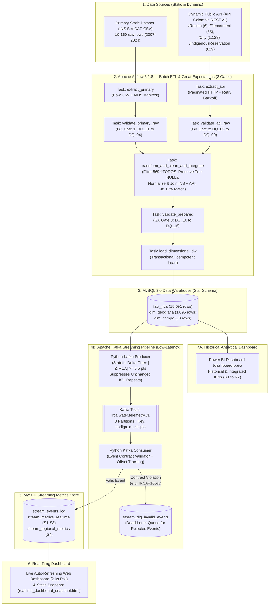

# Integrated Batch and Streaming ETL Architecture — Final Delivery (ODS 6 Water Quality in Colombia)

This architecture implements **Figure 1 (Integrated Batch and Streaming Architecture)** from the Final Delivery specification, combining an automated **Apache Airflow 3.1.8 Batch ETL Pipeline** (with 3 **Great Expectations** validation gates and a **MySQL 8.0 Dimensional Data Warehouse**) with a low-latency **Apache Kafka Event Streaming Pipeline** (`Producer -> Topic -> Consumer -> Streaming Metrics Store -> Real-Time Dashboard`).

