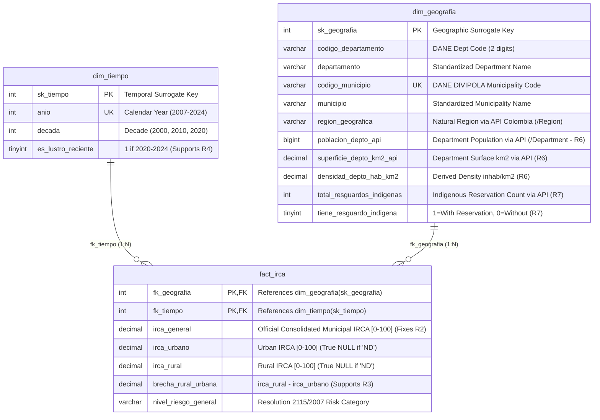

# Dimensional Data Warehouse & Streaming Metrics Store Schema — Final Delivery

## 1. Batch Star Schema (`dw_calidad_agua_colombia`)

## 2. Streaming Metrics Store Tables (`dw_calidad_agua_colombia`)

```mermaid
erDiagram
    stream_events_log {
        varchar event_id PK "UUIDv4 Event Identifier"
        varchar event_timestamp "ISO-8601 UTC Generation Timestamp"
        varchar processed_at_utc "ISO-8601 UTC Consumer Processing Timestamp"
        varchar event_key "Kafka Partition Key (codigo_municipio)"
        varchar event_type "BASELINE_SAMPLE | DELTA_METRIC_UPDATE | CRITICAL_RISK_SPIKE"
        varchar codigo_municipio "DANE DIVIPOLA Code"
        varchar municipio "Municipality Name"
        varchar departamento "Department Name"
        varchar region_geografica "Natural Region"
        int anio_referencia "Reference Year"
        decimal irca_general "Validated IRCA [0-100]"
        decimal delta_irca_prev "Delta vs Previous Municipal Reading"
        varchar nivel_riesgo "Risk Category"
        tinyint tiene_resguardo_indigena "Indigenous Territory Flag (0/1)"
        int kafka_partition "Kafka Partition Number"
        bigint kafka_offset "Kafka Offset"
    }

    stream_metrics_realtime {
        int metric_snapshot_id PK "Auto-increment Snapshot ID"
        varchar updated_at_utc "UTC Timestamp"
        int total_valid_events "Metric S1A: Cumulative Valid Events"
        int total_rejected_events "Metric S1B: Cumulative Rejected Events (DLQ)"
        decimal rolling_avg_irca_general "Metric S1: Rolling 50-Event General IRCA"
        decimal rolling_avg_irca_rural "Metric S1C: Rolling 50-Event Rural IRCA"
        int critical_alerts_count "Metric S2A: Active High Risk (>35%) Alerts"
        int inviable_sanitaria_count "Metric S2B: Sanitarily Inviable (>80%) Alerts"
        int indigenous_municipalities_alert_count "Metric S3A: Indigenous Territory Alerts"
        decimal indigenous_rolling_avg_irca "Metric S3B: Live Indigenous Avg IRCA"
        decimal non_indigenous_rolling_avg_irca "Metric S3C: Live Non-Indigenous Avg IRCA"
        decimal indigenous_gap_pts "Metric S3: Live Indigenous Gap (pts)"
    }

    stream_regional_metrics {
        varchar region_geografica PK "Natural Region Name"
        int events_processed "Events Processed for Region"
        decimal avg_irca_general "Metric S4: Regional Live Average IRCA"
        decimal max_irca_recorded "Max IRCA Recorded in Region"
        int critical_alerts_count "Regional Critical Alerts (>35%)"
        int indigenous_alerts_count "Regional Indigenous Alerts"
    }

    stream_dlq_invalid_events {
        int dlq_id PK "Dead-Letter Queue ID"
        varchar rejected_at_utc "Rejection UTC Timestamp"
        varchar violation_code "Contract Violation Code"
        text violation_detail "Detailed Contract Failure Reason"
        text raw_payload "Rejected Raw Message Payload"
        int kafka_partition "Kafka Partition"
        bigint kafka_offset "Kafka Offset"
    }
```

